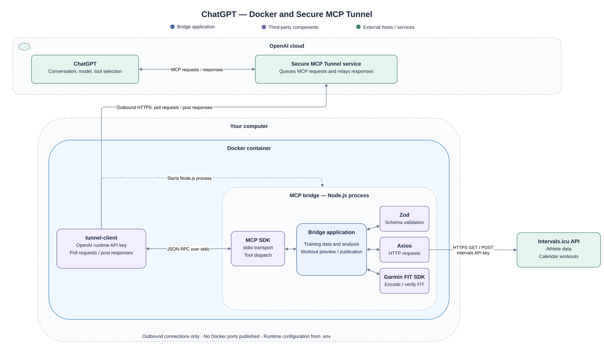
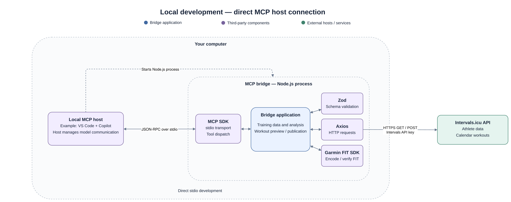
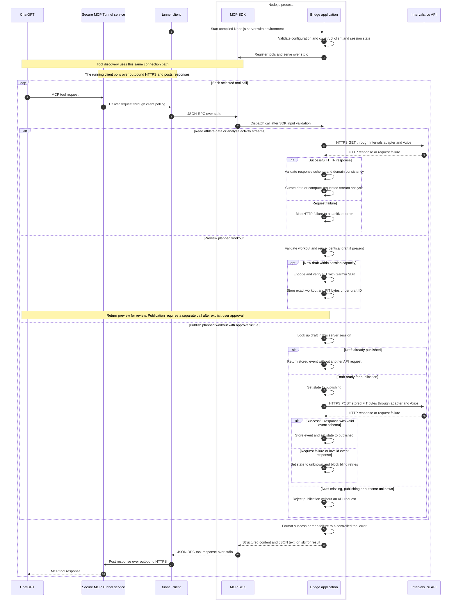

# Architecture

This document describes the bridge's own decisions: how upstream data becomes
usable tool results, how calculations are kept reliable, and how a reviewed
workout becomes a controlled calendar write. MCP wire semantics and Intervals
field definitions belong to their upstream documentation and the source contracts.
See [README.md](README.md) for setup, supported tools and CI/CD.

### ChatGPT through Docker and Secure MCP Tunnel

ChatGPT sends MCP requests to OpenAI's Secure MCP Tunnel service. The local
`tunnel-client` initiates outbound HTTPS polling with its OpenAI runtime key,
retrieves requests and posts responses. The service does not open an inbound
connection to the computer, and the container publishes no ports.

Docker Compose runs the tunnel client and bridge in one container. The tunnel
client starts the compiled bridge as a separate Node.js child and exchanges MCP
JSON-RPC messages over stdio. Compose's init process forwards signals and reaps
exited children. The Docker boundary packages the processes together; the Node.js
boundary contains the MCP SDK, bridge application and its loaded libraries.

Compose reads the local `.env` for both components. OpenAI settings are mapped to
the tunnel client's environment variables, while the file is mounted for the
Node.js child to load its Intervals settings. The OpenAI runtime key authenticates
the tunnel; the Intervals key authenticates API calls. Both processes can access
the shared configuration, so this is not a credential isolation boundary.
Credentials are supplied at runtime and excluded from the image and repository.

### Local development through an MCP host

A local MCP host, such as VS Code with Copilot, starts the compiled bridge directly
and exchanges MCP JSON-RPC messages over stdio. This path requires neither Docker
nor a tunnel. The host manages model communication and the conversation; the
bridge does not call a model API.

Both launch modes use the same server code with one configured athlete and
Intervals API key per process. Inside the bridge, the MCP SDK dispatches calls to
the application. The application uses Zod for schema validation, Axios for HTTPS
requests to Intervals.icu, and Garmin FIT SDK for workout encoding and verification.
Only the Axios connection reaches the external Intervals API.

Each launched bridge owns its own in-memory drafts and publication results.
The Docker and local development processes cannot share draft IDs. Restarting
either process loses its state.
See [reviewed workout state](#reviewed-workout-state) for publication guarantees and
[README](README.md#setup) for setup and startup instructions.

## Communication flow

This sequence documents the ChatGPT/Docker runtime. It focuses on the bridge's
input contracts, upstream data processing and reviewed workout state. The tunnel
and MCP SDK are shown only as the connection and dispatch path; their internal
protocol behaviour is left to upstream documentation. Library operations are
summarised inside the bridge rather than expanded into separate lifelines.

The arrows to Intervals summarise calls through our HTTP adapter and Axios, not
a direct network implementation in the tool handlers. Successful HTTP responses
are schema-validated with Zod before domain checks and analysis. Validation or
processing failures return controlled errors; they do not continue as successful
data. A tool may require several upstream reads; the diagram groups that work
into one interaction. SDK-rejected inputs never reach the handler.

Preview and publication are separate calls. ChatGPT presents the preview and
obtains approval for that exact draft before requesting publication. The server
checks the approval argument and draft state; it cannot inspect conversation
consent. A failed publication attempt has an uncertain outcome because the event
may already exist upstream, so the server blocks automatic retries.

For local development, the MCP host starts the same bridge directly and exchanges
stdio messages with the SDK. The tunnel participants are absent; application
processing and session-state rules remain the same.

## Composition and ownership

| Responsibility                | Code and architectural purpose                                                                                                            |
| ----------------------------- | ----------------------------------------------------------------------------------------------------------------------------------------- |
| Composition and configuration | Entry point and server factory construct the configured client, tool registry and session state.                                          |
| MCP interface                 | Tool adapters and the shared result adapter translate MCP calls into application operations and return curated data or controlled errors. |
| Application logic             | Stream analysis and reviewed workout drafts provide the behavior specific to this bridge. The sections below explain their constraints.   |
| Intervals integration         | The Intervals client and HTTP adapter isolate upstream endpoints, authentication, response validation and consistency checks.             |

The MCP SDK supplies transport and dispatch. Supporting libraries supply schema
validation (Zod), HTTP execution (Axios) and FIT encoding/decoding (Garmin SDK).
They run inside the process; Intervals.icu is the external service reached over
HTTPS. The host owns model communication, while the bridge owns Intervals access.

### Data contracts and processing

The shared result adapter returns the same successful object as structured content
and JSON text for host compatibility. It encloses the application operation,
including HTTP and tool-side processing. Known HTTP errors retain their sanitized
message, while other exceptions use a fixed tool-specific message. Credentials,
raw responses and arbitrary exception details do not reach the model.

The MCP SDK validates tool inputs, and the HTTP adapter validates upstream
responses before application processing. Response schemas select exposed fields.
The Intervals client then enforces domain
consistency, such as athlete identity, wellness date integrity and stream alignment.
Missing observations remain absent or null. Wellness fitness/fatigue values come
from Intervals rather than a fitness or medical-readiness model calculated here.

Zone settings are numeric arrays returned as recorded. Non-increasing boundaries
produce advisory `zoneWarnings` without replacing or rejecting the values. The
bridge does not repair upstream configuration; statistics retain their own explicit
input requirements.

Stream presentation and numerical analysis are separate operations. Sampling keeps
overviews manageable, paging preserves original readings, and statistics use
full-resolution data with coverage information. This prevents presentation sampling
from changing numerical analysis. Output limits do not bound the upstream download.
Detailed units, gap rules and zone semantics stay in source contracts and tests.

### Reviewed workout state

The preview/publish split binds approval to a concrete artifact. Preview validates
a workout, encodes and verifies its FIT representation, and stores the workout and
bytes in a bounded, session-scoped registry. Content hashing reuses identical
previews. Publication uses the stored bytes rather than regenerating the workout.

Drafts transition through ready, publishing, published or unknown states. The
publication guard prevents overlapping writes and returns the stored event after
a successful publication. An uncertain outcome blocks retries because a timeout
or invalid response can occur after Intervals has already created the event.

Restarting the process loses drafts and stored event results. The draft external
ID is not a durable idempotency guarantee. Explicit user approval is enforced by
the host workflow, while the server checks the approval argument and draft state.
It cannot independently inspect conversation consent.

## Maintaining these boundaries

Add endpoint integration and response contracts in the Intervals layer, then
register a tool using the shared result adapter. Keep calculations independent of
transport and keep write state explicit. Tests mock upstream HTTP and exercise
SDK discovery/calls through in-memory transport; they verify our contracts without
requiring live credentials.

Container smoke checks exercise the compiled stdio entry point and FIT workflow
against a mock Intervals API. A separate mock control-plane check exercises the
actual tunnel binary's startup, readiness and graceful shutdown. These checks do
not replace a live ChatGPT read and approved publication acceptance test.

Update the diagrams when responsibilities, dependencies, transport or state
ownership change. Leave detailed field rules in schemas/tool descriptions and CI
steps in the workflow files.

Upstream references: [MCP SDK](https://ts.sdk.modelcontextprotocol.io/v2/),
[Intervals API](https://intervals.icu/api-docs.html),
[Garmin FIT workouts](https://developer.garmin.com/fit/articles/file-types/workout.html).
