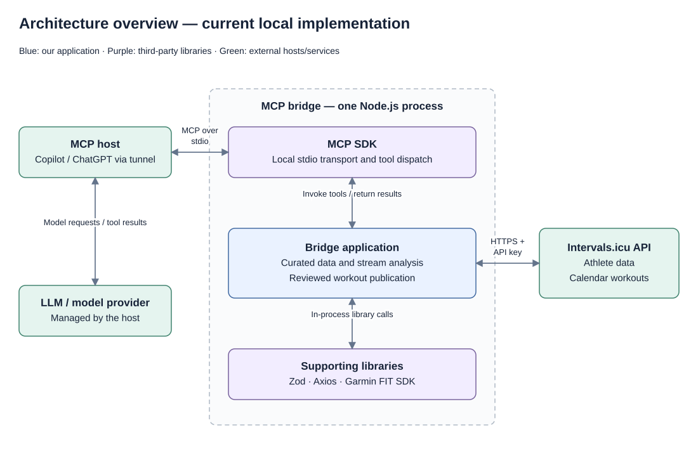
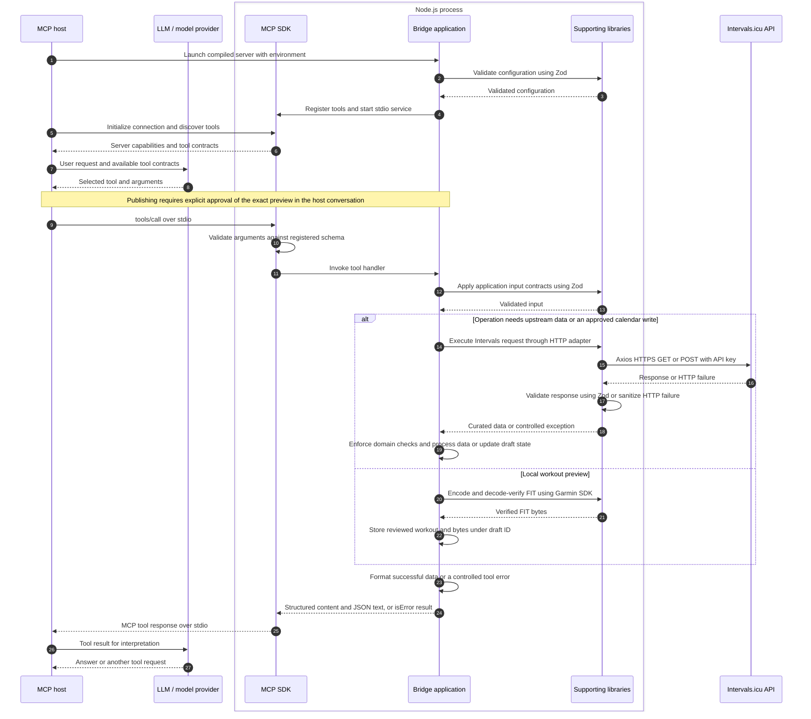

# Architecture

This document describes the bridge's own decisions: how upstream data becomes
usable tool results, how calculations are kept reliable, and how a reviewed
workout becomes a controlled calendar write. MCP wire semantics and Intervals
field definitions belong to their upstream documentation and the source contracts.
See [README.md](README.md) for setup, supported tools and CI/CD.

## Component map and host boundaries

The editable [draw.io diagram](docs/diagrams/architecture.drawio) shows the main
participants and communication boundaries. Open it in diagrams.net or a draw.io
editor. Box titles and descriptions are separate editable text objects attached
to their box, with bold titles and centered descriptions matching the SVG preview.
Export an updated SVG preview after editing.

The grey frame is one running Node.js process. It contains our application and the
third-party libraries it loads. Blue identifies our application code, purple
identifies third-party libraries, and green identifies external hosts/services.
Connections show communication or library calls, with results returning along the
same path. They do not prescribe execution order or expose individual tool paths.

The bridge runs in Node.js with one configured athlete and API key per process.
VS Code + Copilot is the tested host. Other stdio-capable hosts can use the same
entry point, but are not validated by this repository. The host manages the model
and conversation: the bridge does not call an LLM provider or hold a model API key.

## Communication flow

This sequence uses the same participants as the component map. It shows a typical
tool interaction after startup. The supporting-library participant groups in-process
Zod, Axios and Garmin SDK calls, not a separate service. Host/model exchanges are
conceptual and managed by the host.

Tool selection and interpretation happen in the host/model interaction. The bridge
executes explicit calls against the configured athlete. The SDK rejects invalid
arguments before invoking a handler. Configuration failures stop startup, and
application failures are mapped to controlled tool errors. The diagram shows the
normal startup and accepted-call path rather than every validation branch.

A preview is local and performs no Intervals write. Publication is a separate
call using the reviewed draft. Repeating a successful publication can return its
stored result without another HTTP request. A host may make several tool calls
before answering the user.

## Composition and ownership

| Responsibility                | Code and architectural purpose                                                                                                            |
| ----------------------------- | ----------------------------------------------------------------------------------------------------------------------------------------- |
| Composition and configuration | Entry point and server factory construct the configured client, tool registry and session state.                                          |
| MCP interface                 | Tool adapters and the shared result adapter translate MCP calls into application operations and return curated data or controlled errors. |
| Application logic             | Stream analysis and reviewed workout drafts provide the behavior specific to this bridge. The sections below explain their constraints.   |
| Intervals integration         | The Intervals client and HTTP adapter isolate upstream endpoints, authentication, response validation and consistency checks.             |

The MCP SDK supplies transport and dispatch. Supporting libraries supply schema
validation (Zod), HTTP execution (Axios) and FIT encoding/decoding (Garmin SDK).
They run inside the process; Intervals.icu is the external service reached over
HTTPS. The host owns model communication, while the bridge owns Intervals access.

### Data contracts and processing

The shared result adapter returns the same successful object as structured content
and JSON text for host compatibility. It encloses the application operation,
including HTTP and tool-side processing. Known HTTP errors retain their sanitized
message, while other exceptions use a fixed tool-specific message. Credentials,
raw responses and arbitrary exception details do not reach the model.

Response schemas select exposed fields. The Intervals client then enforces domain
consistency, such as athlete identity, wellness date integrity and stream alignment.
Missing observations remain absent or null. Wellness fitness/fatigue values come
from Intervals rather than a fitness or medical-readiness model calculated here.

Stream presentation and numerical analysis are separate operations. Sampling keeps
overviews manageable, paging preserves original readings, and statistics use
full-resolution data with coverage information. This prevents presentation sampling
from changing numerical analysis. Output limits do not bound the upstream download.
Detailed units, gap rules and zone semantics stay in source contracts and tests.

### Reviewed workout state

The preview/publish split binds approval to a concrete artifact. Preview validates
a workout, encodes and verifies its FIT representation, and stores the workout and
bytes in a bounded, session-scoped registry. Content hashing reuses identical
previews. Publication uses the stored bytes rather than regenerating the workout.

Drafts transition through ready, publishing, published or unknown states. The
publication guard prevents overlapping writes and returns the stored event after
a successful publication. An uncertain outcome blocks retries because a timeout
or invalid response can occur after Intervals has already created the event.

Restarting the process loses drafts and stored event results. The draft external
ID is not a durable idempotency guarantee. Explicit user approval is enforced by
the host workflow, while the server checks the approval argument and draft state.
It cannot independently inspect conversation consent.

## Maintaining these boundaries

Add endpoint integration and response contracts in the Intervals layer, then
register a tool using the shared result adapter. Keep calculations independent of
transport and keep write state explicit. Tests mock upstream HTTP and exercise
SDK discovery/calls through in-memory transport; they verify our contracts without
requiring live credentials.

Update the diagrams when responsibilities, dependencies, transport or state
ownership change. Leave detailed field rules in schemas/tool descriptions and CI
steps in the workflow files.

Upstream references: [MCP SDK](https://ts.sdk.modelcontextprotocol.io/v2/),
[Intervals API](https://intervals.icu/api-docs.html),
[Garmin FIT workouts](https://developer.garmin.com/fit/articles/file-types/workout.html).
