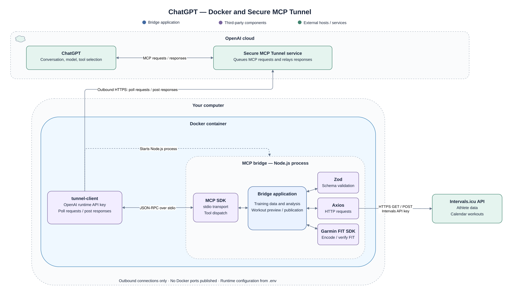
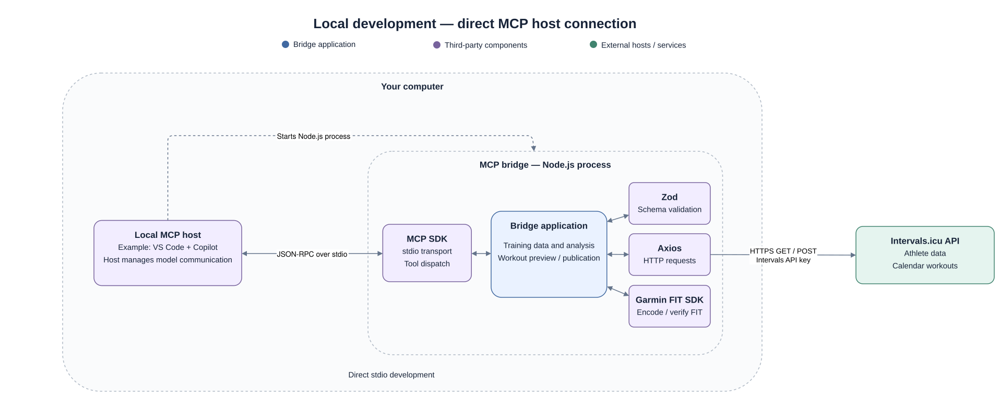
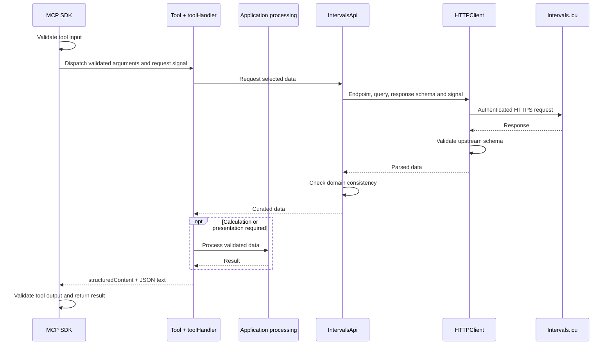

# Architecture

The bridge provides validated training data, deterministic calculations and
controlled workout publication. The MCP host owns model communication and
coaching decisions; the bridge does not call an LLM API.

See the [README](../README.md) for installation and usage, and
[Development](development.md) for build commands, imports, Git hooks and CI/CD.

## 1. Runtime overview

Both launch modes run the same MCP server, configured with one Intervals athlete
and API key per process. The MCP SDK handles protocol negotiation, discovery and
dispatch. Zod validates contracts, Axios handles HTTP, and the Garmin FIT SDK
encodes and verifies workouts. These libraries run inside the Node.js process;
Intervals.icu is the external data service.

### ChatGPT through Docker and Secure MCP Tunnel

The local tunnel client retrieves ChatGPT requests through outbound HTTPS
polling and returns responses through the same service. It starts the compiled
bridge as a child process and exchanges MCP JSON-RPC messages over stdio.
Docker Compose packages both processes together, publishes no ports and uses
an init process to forward signals and reap child processes.

### Local MCP host

A local host, such as VS Code with Copilot, starts the compiled bridge directly
and exchanges the same stdio messages. Docker and the tunnel are absent; the
application logic is unchanged.

## 2. Application structure and key files

Paths below are relative to the repository root. Each feature owns its contracts;
upstream response schemas, application models and MCP input/output schemas have
separate locations.

- **`src/index.ts`**

  Application startup: load configuration, start the server and report
  synchronous startup failures.

- **`src/mcp/server.ts`**

  MCP server composition: create the API client and draft registry, register
  tools and start the SDK transport.

- **`src/mcp/tools/`**

  MCP tool implementations. Our convention is one `<tool-name>/` folder per tool:

  - `tool.ts`: the operation.
  - `schemas.ts`: its input/output contracts.

  The sibling `shared/` folder contains helpers and schemas used by multiple
  tools, including `tool-handler.ts`.

- **`src/app/`**

  Bridge-specific business logic:

  - `activity-streams/`: sampled overviews, lossless pages and statistics.
  - `workouts/`: the workout model, FIT encoding and draft/publication workflow.
  - `athlete-settings/`: advisory warnings added to athlete settings.

- **`src/intervals/`**

  Intervals.icu integration: connection configuration, API endpoint calls,
  response consistency checks and upstream schemas.

- **`src/http/`**

  Authenticated HTTP requests, response validation, timeouts and HTTP error
  translation.

- **`src/shared/`**

  Common files used across application features.

- **`src/errors.ts`**

  Application error classes with controlled public messages.

- **`Dockerfile`, `compose.yaml`, `docker/`**

  Container packaging and configuration for the tunnel and bridge processes.

- **`tests/`, `docs/`**

  Automated verification and project documentation.

## 3. Communication between layers

Tools coordinate the Intervals adapter and application operations. Simple reads
can return curated API data directly; stream tools fetch data before calculating
an overview, page or statistics. Workout preview stays local, while publication
uses the draft registry and API adapter.

The sequence below follows a successful network-backed read. The runtime diagrams
above show how the request reaches the SDK.

### Validation and data meaning

The SDK validates tool inputs; the HTTP client validates upstream responses;
`IntervalsApi` checks domain consistency such as athlete identity, wellness dates
and stream alignment. Internal methods consume validated arguments rather than
reparsing them. Direct callers of workout preview must first parse raw input into
the branded, normalized `PlannedWorkout` model.

Response schemas select exposed fields. Missing observations remain absent or
null. Date ranges are explicit inclusive athlete-local dates; the host resolves
relative dates using athlete settings, and the bridge forwards the dates without
conversion. Non-increasing zone settings produce advisory warnings without
repairing the original values. Detailed limits and units belong to the schemas.

Stream overview sampling, lossless paging and full-resolution statistics are
separate operations. Sampling does not feed numerical analysis, and statistics
report data coverage. Output limits do not limit the upstream download. Wellness
fitness/fatigue values come from Intervals; the bridge does not calculate a
medical-readiness or coaching model.

## 4. State and publication guarantees

`WorkoutDrafts` owns an in-memory registry per server instance, limited to 100
distinct drafts including published ones. Instances do not share drafts, and
restarting loses their draft and result records. Published Intervals events remain
upstream; this registry provides no durable, cross-restart idempotency guarantee.

Preview snapshots the normalized workout, generates and verifies its FIT bytes,
and returns the workout and artifact metadata for review. Identical content
reuses the draft. Publication sends those stored bytes rather than regenerating
an artifact. Approval requirements are described under [Security](#6-security).

| State        | Meaning and behavior                                                                                          |
| ------------ | ------------------------------------------------------------------------------------------------------------- |
| `ready`      | Validated artifact is available for review and publication.                                                   |
| `publishing` | A write has started; concurrent publication is blocked.                                                       |
| `published`  | The validated event is stored; repeated publication returns it without another write.                         |
| `unknown`    | A started attempt failed; the event may already exist upstream. Further publication of this draft is blocked. |

The transition to `publishing` happens before the API call. Success stores the
returned event; any failure after that transition marks the draft `unknown`.
Cancellation before the transition leaves it `ready`. An external ID accompanies
the event, but does not establish upstream deduplication. Uncertain results require
calendar inspection, never blind recreation or automatic retry.

## 5. Error handling and cancellation

Each boundary handles its own failures:

- **Configuration / startup**

  Configuration errors have controlled messages. The entry point reports
  synchronous startup failures to stderr and sets a failure exit code.

- **`HTTPClient`**

  Axios failures become `HTTPError` with status or a generic network/timeout
  message. Invalid responses become `UpstreamDataError`.

- **Application / adapter**

  Domain failures use `AppError` subclasses. Publication failures also follow
  the state rules above.

- **`toolHandler`**

  Pass expected `AppError` messages through; replace unexpected errors with a
  generic internal-error message. Original causes remain internal.

- **MCP SDK**

  Handle protocol/input validation and convert handler exceptions into error
  results. Output-schema validation occurs outside `toolHandler`.

Network tools forward `ctx.mcpReq.signal` through the adapter to HTTP requests.
The client combines caller cancellation with a 15-second deadline and also sets
an Axios timeout. It currently performs no automatic retries. An aborted request
does not prove that an upstream write was cancelled; publication follows
[the draft state rules](#4-state-and-publication-guarantees).

The SDK manages transport lifetime and EOF teardown. SIGINT/SIGTERM request
shutdown through its handle; connection teardown aborts in-flight requests.
Transport failures follow SDK behavior rather than a custom transport wrapper.

## 6. Security

### Access and credentials

The OpenAI runtime key authenticates the tunnel, while the Intervals API key
provides Basic authentication for upstream requests. The bridge relies on the
host/tunnel for caller access; it is not a multi-user service with separate user
identities and credentials. Local MCP access is controlled by the host process.

Compose maps OpenAI settings from `.env` into tunnel environment variables and
mounts the configuration file as a secret for the Node child. Both processes can
access the shared configuration; the container is not a credential-isolation
boundary. Credentials are supplied at runtime and excluded from Git and the
published image. HTTP redirects are disabled.

### User approval and exposed data

The host must show the preview and obtain approval for that exact workout and
date. The publication tool requires `approved: true` and a known draft ID, but
these are client assertions: the server cannot independently verify conversation
consent. A changed workout needs a new preview and approval.

Curated schemas restrict tool output, and controlled error messages avoid exposing
credentials, raw upstream error bodies or arbitrary exception details to the model.
SDK-generated schema diagnostics are outside the application error wrapper, so
schema descriptions and validation messages must also be safe to expose.
Diagnostics belong on stderr and must not contain secrets or raw athlete data.

Reference behavior remains defined by the [MCP SDK](https://ts.sdk.modelcontextprotocol.io/v2/),
[Intervals API](https://intervals.icu/api-docs.html) and
[Garmin FIT SDK](https://developer.garmin.com/fit/articles/file-types/workout.html).
