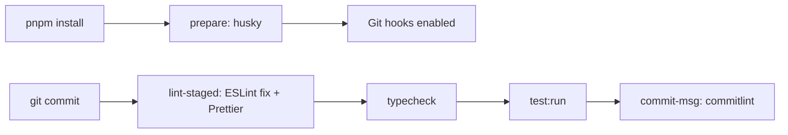
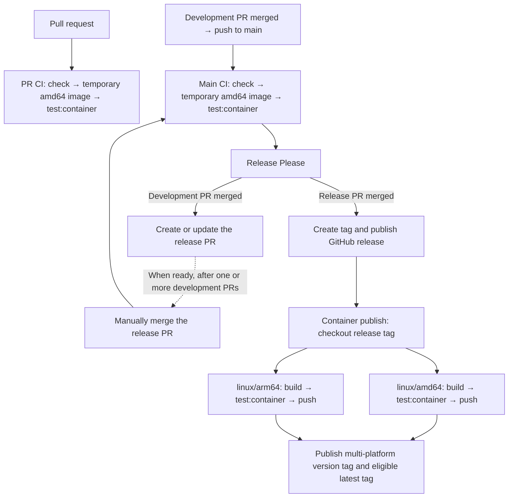

# Development

Local setup, development commands, Git hooks and CI checks. For application
installation and usage, see the [README](../README.md); for component
responsibilities and data flow, see [Architecture](architecture.md).

Run all commands below from the repository root. Use Node.js 24 and the pnpm
version pinned in [package.json](../package.json).

## Install

> [!NOTE]
> Direct local execution requires only the Intervals settings in `.env`.
> The `OPENAI_` variables and an OpenAI tunnel are not needed.

Clone the repository and create `.env` from `.env.example` in its root.
Install dependencies from the repository root:

```sh
pnpm install
```

The normal `pnpm install` automatically runs `prepare` (`husky`), which
configures Git to use the hooks committed under `.husky/`. No separate setup command is needed.

If installation locally used `--ignore-scripts`, run `pnpm run prepare` once afterwards to enable hooks in your development checkout.

> [!WARNING]
> Do not run `husky init` in this repository. It already contains its hook definitions; initialization can overwrite the existing pre-commit hook.
> Use `pnpm run prepare` to enable the existing setup instead.

Docker installs and the image-publishing dependency install use
`--ignore-scripts`. Normal PR/main CI installs also run `prepare`, but CI runs its checks explicitly rather than relying on a Git commit hook.

## Build

Build the server:

```sh
pnpm build
```

Run the MCP server directly through an MCP host.

### Why two TypeScript configurations?

- `tsconfig.json` holds shared compiler settings and includes application code,
  tests and the Vitest configuration. The pre-commit hook uses it through
  `pnpm typecheck` (`tsc --noEmit`), checking everything without generating files.
- `tsconfig.build.json` inherits those settings but includes only `src/`.
  Local and Docker builds select it through `pnpm build`
  (`tsc -p tsconfig.build.json`), producing `dist/src/` without tests or test-runner
  configuration. The Docker build therefore does not need the test sources.

PR/main CI runs both through `pnpm check`: the wider development scope is checked,
then an application-only build is produced. Compiler settings remain in one place.

## Project-specific development notes

### Internal imports

Use native Node package imports such as `#app/`, `#intervals/` and `#mcp/` across
features, and relative imports such as `./schemas.js` for nearby files. Keep the
`.js` extension in both cases. Mappings live in the `imports` field of
[package.json](../package.json); do not duplicate them in `tsconfig.paths`.

Typechecking and Vitest resolve imports to TypeScript sources; the compiled
application resolves them to JavaScript under `dist/`, as used in the MCP host setup.

### Logging over MCP stdio

`stdout` is reserved for MCP protocol messages. Write diagnostics to `stderr`
(for example, with `console.error`), not `console.log`: extra output on `stdout`
can break communication with the MCP host. Do not log credentials or raw athlete
data when debugging.

## Commands and automatic checks

| Script           | Purpose                                                  | Invoked automatically by                      |
| ---------------- | -------------------------------------------------------- | --------------------------------------------- |
| `check`          | Full source quality gate and build                       | PR and main CI                                |
| `build`          | Compile the application to dist/                         | `check`, container build                      |
| `typecheck`      | Check TypeScript syntax and types without emitting files | `check`, Husky pre-commit                     |
| `lint`           | Check ESLint rules, including import sorting; no fixes   | `check`                                       |
| `format:check`   | Check Prettier formatting; no modifications              | `check`                                       |
| `test:run`       | Run the source suite once, without coverage              | Husky pre-commit                              |
| `test:coverage`  | Run source tests and enforce coverage thresholds         | `check`                                       |
| `test:container` | Test the compiled application in Docker                  | PR/main CI and container publishing workflows |
| `prepare`        | Configure Husky to use the repository Git hooks          | `pnpm install` (locally and in CI)            |

Typical manual commands:

```sh
pnpm test:run    # While working on application logic
pnpm check      # Source quality gates and a build
```

## Docker builds and supported architectures

Release publishing builds two Linux images in parallel, on native runners:

| Image platform | Runner             | Typical machines                    |
| -------------- | ------------------ | ----------------------------------- |
| `linux/amd64`  | `ubuntu-24.04`     | Intel/AMD PCs and Intel Macs        |
| `linux/arm64`  | `ubuntu-24.04-arm` | Apple Silicon Macs and ARM machines |

These are CPU architectures, not separate Windows and macOS builds. Docker
Desktop supplies the Linux environment on those operating systems. After both
images pass their container tests, publishing creates a multi-platform manifest
under the version tag and, for the latest release, `latest`. Docker selects the
matching platform when pulling the shared image name.

PR/main CI builds and tests only `linux/amd64` for early feedback. Release
publishing builds from the release tag and tests both images that will actually
be pushed. It already reuses GitHub Actions build cache per architecture.

## Local MCP host: VS Code and Copilot

> [!NOTE]
> Requires VS Code 1.140 or later. Copilot Free is sufficient.

Create a file named `.mcp.json` in the repository root with the following content:

```json
{
  "mcpServers": {
    "intervals-mcp-bridge": {
      "type": "stdio",
      "command": "node",
      "args": ["--env-file=/absolute/path/to/.env", "/absolute/path/to/dist/src/index.js"],
      "tools": ["*"]
    }
  }
}
```

Replace both example paths with absolute paths to your local checkout. The `.mcp.json` file is ignored by Git by default because it contains
machine-specific paths; each developer creates their own local copy.

Start the MCP using VS Code's MCP controls.
Ask Copilot for your recent activities to verify the connection.

After source
changes, rebuild and restart the server. VS Code manages the process over stdio.

## CI/CD

- **GitHub Actions:** [PR quality gates](../.github/workflows/pr-qgate.yml),
  [main validation and releases](../.github/workflows/release.yml), and
  [Docker image publishing](../.github/workflows/publish-image.yml).
- **Release Please:** release PRs, versioning, changelog and GitHub releases.
- **Husky and lint-staged:** staged-file formatting/linting, automatic import sorting via ESLint, type checks and tests before commits.
- **commitlint:** Conventional Commits enforcement.

### Automatic execution

A failed check prevents subsequent steps on its path. Local hooks provide
feedback before a commit; GitHub Actions validates changes and publishes releases.

#### Local Git hooks



#### GitHub Actions



After a development PR is merged to main and CI passes, Release Please creates
a release PR if releasable changes exist, or updates the existing one. Development
PR merges do not each publish a release. Keep the release PR open to collect as
many PRs as appropriate, then merge it manually
when the changes form a release-ready batch.

The diagram's `PR CI` and `Main CI` steps each build a temporary amd64 image for
testing only. The later `linux/amd64: build → test:container → push` and
`linux/arm64: build → test:container → push` steps build new images from the
release tag, test them and push them to the registry. They do not repeat the
source checks that already passed in `Main CI`.
